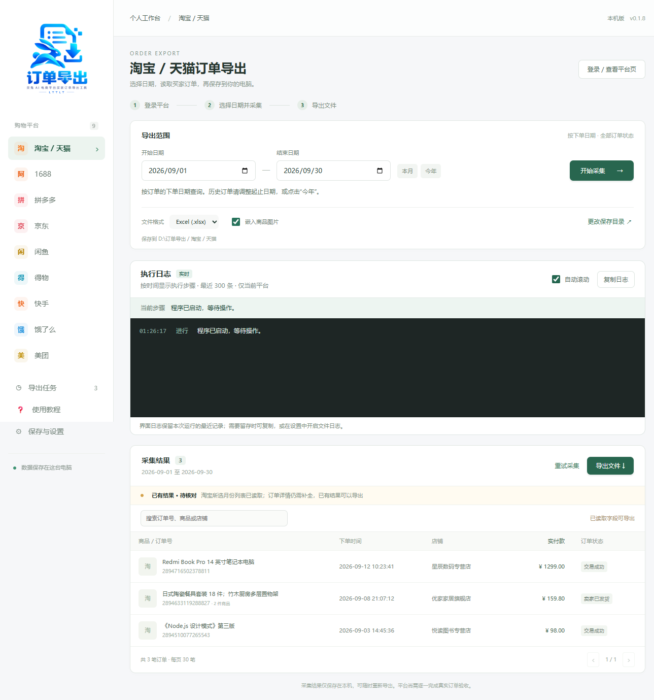
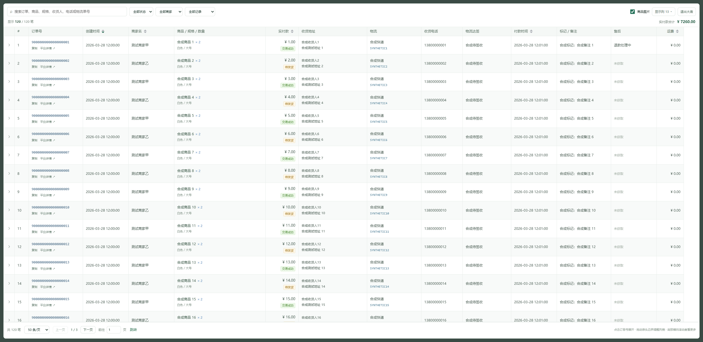
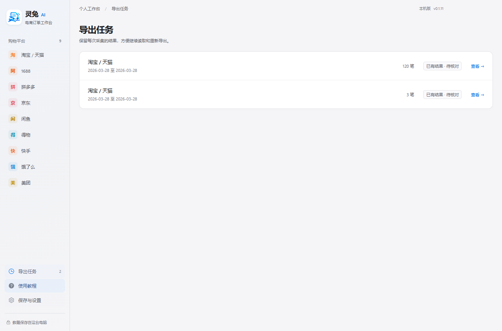

<div align="center">


# E-commerce Purchase Order Export

**Your purchase history. Organized, searchable, exportable.**

Collect buyer-side order history on Windows and turn it into Excel / CSV.

[简体中文](README.md) · **English**

[](https://github.com/907609732/lingtu-order-export/releases/latest)
[](https://github.com/907609732/lingtu-order-export/actions/workflows/build.yml)
[](https://github.com/907609732/lingtu-order-export/actions/workflows/sync-gitee.yml)


**[Download for Windows](https://github.com/907609732/lingtu-order-export/releases/latest)** · [Website](https://buyer.lttlt.top/) · [Guide (中文)](https://buyer.lttlt.top/guide.html) · [Report an issue](https://github.com/907609732/lingtu-order-export/issues)

</div>

---

## Product preview



<p align="center"><sub>Synthetic demonstration data from an earlier version; some labels differ from the current release.</sub></p>

| Collect | Review | Export |
| :---: | :---: | :---: |
| Choose a platform and date range | Inspect items and missing fields | Save Excel / CSV locally |

[Features](#features) · [Platforms](#platforms-and-collection-methods) · [Quick start](#quick-start) · [Data & privacy](#data-and-network-connections) · [Development](#run-from-source)

## Download and install

Current public release: **v0.1.21**. The application is now named “电商平台采购订单导出”. The desktop interface and illustrated guide are currently in Chinese; this page provides English documentation.

Open [GitHub Releases](https://github.com/907609732/lingtu-order-export/releases/latest) and download the Windows x64 installer named `LingtuOrderExport-<version>-Setup.exe`. The Source code ZIP is not an installer.

Existing order and login data directories remain compatible. Back up important exports before upgrading. The installer is not code-signed; check its source and SHA-256 on the release page.

## Features

| Capability | What you can do |
| --- | --- |
| 📅 Historical collection | Select order dates, create daily or monthly extraction plans, pause and resume. |
| 🔎 Order details | Review products, variants, quantities, amounts, addresses and logistics; search and filter results. |
| 🖼️ Excel with images | Embed product images in Excel; retain image links and record missing data when downloads fail. |
| 📄 CSV export | Export text-only tables for further processing. CSV does not embed images. |
| 💾 Local tasks | Reopen saved tasks, review collected orders and export again. |
| 📋 Execution logs | Follow collection, detail extraction and export progress. |

## Platforms and collection methods

| Platforms | Collection method |
| --- | --- |
| Taobao / Tmall, 1688, Pinduoduo, JD.com, Xianyu | Open the official platform page inside the application and sign in yourself |
| Dewu, Kuaishou, Ele.me, Meituan | Assisted collection through WeChat Mini Programs; follow the in-app certificate and proxy setup guide |

These are the platform entries offered by the application. They do not mean that every platform, account, or historical date range has passed live-order validation. Page changes, login sessions, verification challenges, and platform query limits can affect collection. Compare exported counts, amounts, and missing fields with the official order pages.

## Quick start

1. Install the application, open it, and select a platform.
2. Click “登录 / 查看平台页” (Sign in / View platform page) and sign in on the official page. For Mini Program platforms, follow the built-in guide.
3. Choose a range by order date. Start with a day containing only a few orders.
4. Start collection, extract details as needed, and review the execution logs and missing fields.
5. Choose an output folder and Excel or CSV format in the save/export settings, then click “导出文件” (Export file).

After assisted Mini Program collection, restore your original proxy settings as described in the guide.

## A closer look

| Order details and filtering | Task history |
| --- | --- |
|  |  |

## Data and network connections

Orders and login sessions are stored locally and are not uploaded to the project's servers. Collection still connects to the relevant e-commerce platforms, and product images may be downloaded from platform URLs.

The application checks GitHub for updates and sends an installation identifier, application version, and launch timestamp to the project's analytics service. Launch analytics do not include account information, orders, or shipping details. Failed network requests do not prevent local data storage.

## Run from source

Stack: Electron, Vue 3, TypeScript, Electron Vite, and ExcelJS. Run the following commands in Windows PowerShell. Node.js 24 and npm are recommended; install Git first.

```powershell
git clone https://github.com/907609732/lingtu-order-export.git
cd lingtu-order-export
npm.cmd ci
node node_modules/electron/install.js
New-Item -ItemType Directory -Force .test-output | Out-Null
npm.cmd run dev
```

Validate and package:

```powershell
npm.cmd run check  # Unit tests, type checking, and production build
npm.cmd run dist   # Windows x64 NSIS installer in release/; no automatic publication
```

Running the source does not validate live platform behavior. When reporting an issue, include the version, platform, reproduction steps, and redacted logs. Do not upload account data, cookies, orders, shipping details, or local application data directories.

## Repositories and releases

GitHub is the primary repository; Gitee is a source mirror. Changes are synchronized from GitHub to Gitee. Use GitHub Releases for installers and release notes.

## License

Original code in this project is licensed under the [MIT License](LICENSE). Commercial use, modification, and redistribution are permitted provided the copyright and license notices are retained. The software is provided without warranty.

Third-party dependencies, platform names and logos, and referenced assets remain subject to their respective licenses or rights notices. This project’s MIT license does not change those rights.

BY 五成
