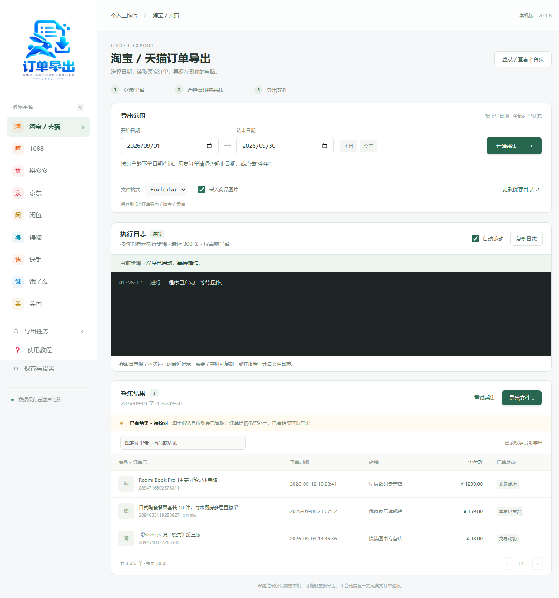
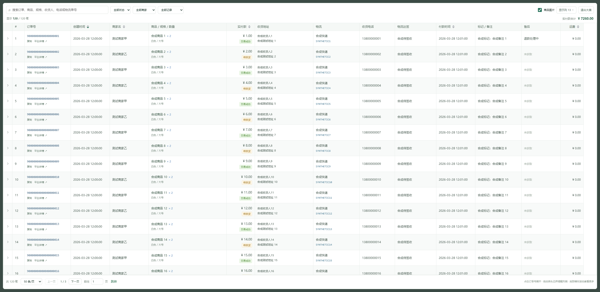
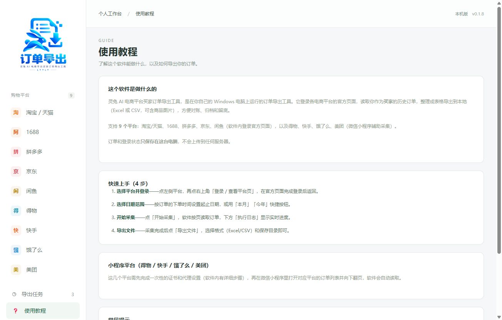
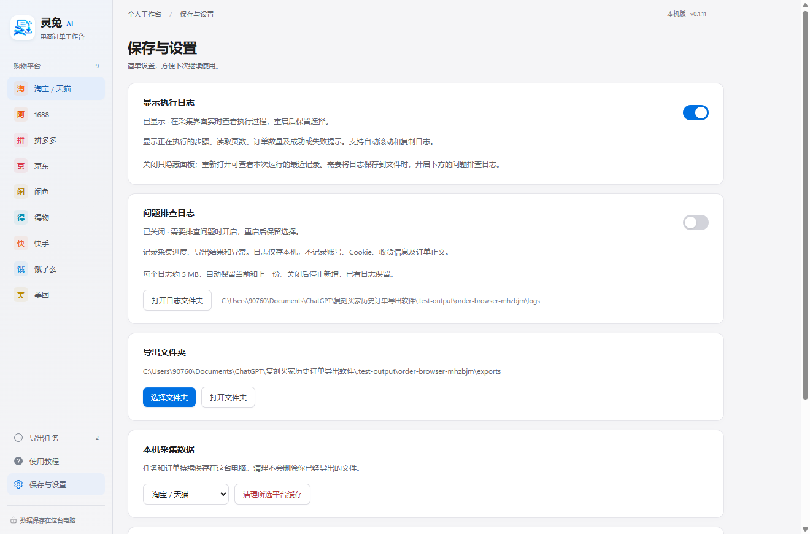
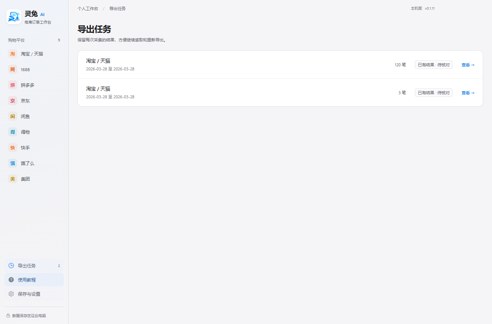

# 灵兔 AI 电商平台买家订单导出工具

Windows 本机电商平台买家订单导出工具（五成）。当前为 **0.1.15 开发验证版**，尚未完成真实账号的逐平台验收。

## 软件截图

> 截图使用合成演示数据，非真实订单。

**采集导出台** —— 选择下单日期范围，实时执行日志显示读取页数和进度，采集结果可直接导出：



**订单大表** —— 多字段、组合筛选、列选择及展开明细：



| 使用教程 | 保存与设置 |
| --- | --- |
|  |  |

**导出任务** —— 保留每次采集的结果，方便继续读取和重新导出：



## 提取计划与详情提醒

0.1.15 支持五个平台按月／按天选择不连续日期、暂停继续和同表导出。淘宝列表正常完成后高亮详情按钮，成功读取后减少待提取数量。详见 [提取计划说明](docs/提取计划.md)。

## 使用

1. 运行 `release/LingtuOrderExport-0.1.14-Setup.exe`，安装后打开桌面的“灵兔 AI 电商平台买家订单导出工具”。
2. 选择平台，点击“登录 / 查看平台页”，在官方页面自行登录。
3. 返回导出台，按订单的下单时间选择起止日期，开始采集。历史订单需调整日期或点击“今年”；日期范围内没有订单时会明确提示，重启后恢复最近的淘宝任务及日期。
4. 在订单表查看商品、规格、数量、金额、收货、物流、付款时间、备注和售后。点击订单号展开全部详情；用“显示列”选择额外字段，“专注看表”打开大表，底部可横向滚动、分页。
5. 淘宝已有订单可点击“提取订单详情”，读取官方页面可见的收货、物流和时间字段；遇到验证时按日志提示自行处理，再点“继续采集”。页面未提供的值仍显示待提取或未获取。
6. 选择保存目录，导出 Excel 或 CSV。Excel 默认嵌入图片；图片失败会保留链接，并记录在缺项清单。表格筛选只影响浏览，“导出文件”始终导出当前任务全部订单。

得物、快手、饿了么、美团的微信小程序采集使用本机辅助代理。首次证书信任及代理切换需用户手动完成，步骤在软件内展示。软件当前不自动修改系统代理或根证书；退出前必须恢复原有代理设置。该部分尚未用真实小程序验证。

## 实时执行日志

采集页面的“执行日志”面板会按时间显示实际步骤：开始采集、加载平台、正在读取第几页、本页和累计订单数、补全详情、处理图片、写入文件、完成或异常。等待超过 10 秒时继续提示当前步骤及等待时长，不估算虚假的进度百分比。

- 默认显示，在“保存与设置 → 显示执行日志”切换，重启后保留显示选择。
- 按当前平台查看最近 300 条，自动滚动，可暂停跟随并回到最新，支持复制日志。
- 界面日志保留本次程序运行的最近记录；关闭显示只隐藏面板，再次开启可看到最近步骤。
- 界面反馈无需开启文件日志。若需要重启后仍保留排查文件，可另行开启下方的“问题排查日志”。
- 不显示账号、订单正文、Cookie、收货信息等原始数据。
- 0.1.4 修复淘宝已登录时仍被误报为需要登录的问题：补齐官方买家页的请求参数，区分登录失效、平台服务错误、请求限制、网络/超时和结构变化；界面及文件日志保留已知错误码，不记录原始错误正文。
- 0.1.5 经 REA 比对实际安装软件：淘宝按月筛选及断点翻页，修正商品合计和 SKU；拼多多改为专用分页接口并逐笔处理详情。日志显示月份、页码和详情进度。见 [REA 比对与修复](docs/REA比对与修复.md)。
- 0.1.6 将淘宝成功查询但无订单的结果标记为“读取完成”，界面和日志明确说明日期范围内没有订单；只有明确的登录错误才提示重新登录。
- 0.1.8 新增应用图标：安装程序、窗口标题栏和任务栏使用统一图标，侧边栏品牌栏由文字改为品牌 Logo 图片。
- 0.1.10 改为可展开、筛选、排序及自选列的数据表；有结果时日志默认收起，采集时展开，仍可在设置中整体开关。增加淘宝官方详情读取与品牌改名后的旧数据目录兼容。见 [订单查看与字段对齐](docs/订单查看与字段对齐.md)。
- 0.1.11 统一为 Logo 蓝色、冷白与浅灰的界面，缩小品牌区、统一导航图标与圆角控件，表格采用轻分隔线，日志改为浅色面板；融合 Windows 原生窗口按钮，保留拖动、最小化、最大化和关闭。见 [界面风格](docs/界面风格.md)。

- 0.1.12 将清理缓存入口移动到每个平台页面右上角，清理前确认当前平台，取消保持数据，确认后立即刷新列表。

- 0.1.13 将采集、导出与筛选操作整合为两行；格式、图片与目录合并到“导出设置”，日志放到表格下方，增加订单显示空间。

- 0.1.14 将日期、采集与导出操作移入平台标题栏；宽屏与清理、登录按钮同排，窄窗口自动换行。

## 关于与更新

- 软件署名「五成」，在“保存与设置 → 关于”查看，并预留官网入口（正式官网确定后替换链接）。
- 启动时后台检查 GitHub Release 是否有新版本；发现新版本在界面顶部提示，可一键前往下载，不影响正常使用。设置页也可手动“检查更新”。
- 每次打开软件会在本机记录一次启动，并上报到自建的 Cloudflare Worker 统计后端（部署见 `server/`）。上报仅含随机设备编号、版本号和时间，不含账号、订单或收货信息；未配置上报地址时仅本机记录、不联网。

## 问题排查日志

在“保存与设置 → 问题排查日志”开启或关闭，默认关闭，重启后保留选择。遇到问题时先开启，再复现操作，然后点击“打开日志文件夹”。

- 路径：`%APPDATA%/灵兔 AI 电商平台买家订单导出工具/logs`，当前文件 `main.log`，上一份 `main.old.log`。若启动环境重定向了 AppData，以设置页显示的实际位置为准。
- 内容：时间、版本、操作阶段、平台、程序生成的任务编号、页数/数量/耗时、异常类别和程序内代码位置。
- 不写入账号、订单号、订单正文、Cookie、Token、收货信息、接口响应、完整网址或输出路径；任意异常原文也不落盘。
- 每份约 5 MB，自动轮换，仅保留当前和上一份。关闭后停止新增，已有文件保留，日志不会自动上传。
- 磁盘不可写时在设置中显示提示，不让日志故障阻断正常业务操作。

## 已验证

- 69 项单元测试：业务、文件日志、执行日志、平台合同、错误分类、组合单、表格筛选排序、详情绑定和旧数据兼容；包括金额单位、日期、大订单号、多商品、持久化、1,000 笔带图导出。
- Electron 实际界面测试：九个平台切换、通过界面触发 Excel 导出、检查订单号/金额/缺项表、重启后保留数据。
- 五个平台的隔离集成测试：淘宝、1688、拼多多、京东跨年、闲鱼列表及详情；同时验证平台页面无法访问本机 IPC。
- 上述测试采用合成数据，不能替代真实平台订单验收。
- 另以真实淘宝登录态做单页只读复核：修复后的请求成功，识别到订单日期、商品和金额；未将这次单页诊断结果写入任务。详情补全和全量范围仍未验收。
- 0.1.6 实际界面采集 2026-03-28 当天的 1 笔淘宝订单并保存，日期、实付款和数量与官方页面一致；原任务保留。详情补全及完整历史范围仍未验收。
- 0.1.10 用现有 1 笔淘宝订单验证详情提取和写回：付款/发货时间、收货人/电话/地址、快递/单号/物流状态均有值并显示；保留 13 个任务、19 笔订单记录。120 笔合成订单验证搜索、筛选、排序、分页、展开、自选列、图片开关及导出；详情验证中断/继续、隐私字段不进入日志通过。

## 当前边界

| 平台 | 当前实现 | 尚需完成 |
| --- | --- | --- |
| 淘宝 / 天猫 | 官方 SDK 按月筛选、断点翻页、组件树及子订单映射；官方可见详情读取；参考主表列及展开详情已实现 | 真实完整范围、特殊订单/多包裹、完整售后与备注详情 |
| 1688 | 官方登录页、按日期分页、分单位金额及独立 SKU | 真实登录、收货/物流/发票详情、原版全字段核对 |
| 拼多多 | 专用 offset 分页、普通/组合单映射、官方 HTML 详情补全、任务账号绑定 | 真实登录及历史范围验收、特殊订单详情、原版导出逐项核对 |
| 京东 | 官方登录页、按年份读取订单表格和翻页 | 真实跨年范围、详情、原版列结构核对 |
| 闲鱼 | 官方 SDK 列表分页和详情补全 | 真实登录、逐字段及完整范围核对 |
| 得物 / 快手 / 饿了么 / 美团 | 选择平台后的本机辅助代理、原版响应字段映射 | 真实小程序、证书与代理使用流程、原版表格核对 |

因此，当前安装包用于联调，不作为“九个平台均已可用”的交付验收结论。程序在无法证明完整性时标记“已有结果 · 待核对”，允许导出已获取的结果。

新用户的数据保存在 `%APPDATA%/灵兔 AI 电商平台买家订单导出工具`。品牌改名前已使用本工具的用户，若新目录没有任务，会继续使用有任务的旧目录（如“买家订单导出台”），连同其中的平台登录状态整体复用，不移动或合并目录。实际位置以设置页为准。每个平台独立登录；第三方软件的安装目录、缓存和账号数据不迁移。导出文件按平台分目录并附时间戳。清理平台采集缓存不会删除已导出文件。

## 开发与验证

环境：Windows x64、Node.js 24、Electron 44。已有系统环境可直接复用。

```powershell
npm.cmd ci
npm.cmd run check
node tests/execution-smoke.mjs
node tests/logging-smoke.mjs
node tests/desktop-smoke.mjs
node tests/collectors-smoke.mjs
node tests/mtop-failures-smoke.mjs
node tests/taobao-pagination-smoke.mjs
node tests/pdd-collector-smoke.mjs
node tests/order-browser-smoke.mjs
npm.cmd run dist
```

`build.electronDist` 使用 `node_modules/electron/dist` 的 Electron 运行时。下载完成后应对照 Electron 包附带的 `checksums.json` 校验压缩包，不使用不完整缓存。当前本机测试安装包未配置发布者代码签名。

## 资料与依赖

参考产品：[魔猫订单下载页](https://order.hereserver.com/#downloads)。只用来研究平台行为和输出字段；研究目录 `.research` 不进入安装包，也不复制原商业软件或其激活机制。

现有方案调查：[淘宝买家订单导出（MIT）](https://github.com/Sky-seeker/BuyerOrdersExport)、[京东订单导出插件（GPL-3.0）](https://github.com/TingXuanR/jd_order_exporter)、[拼多多买家导出教程](https://github.com/zodiac1111/Pinduoduo-buyer-order-export)。这些项目的可用性与当前平台版本需分别验证，当前没有直接打包其代码。

实现依赖 Electron、Vue、[Element Plus 表格](https://element-plus.org/en-US/component/table)、Node SQLite、ExcelJS、json-bigint、http-mitm-proxy 和 [electron-log 5.4.4](https://github.com/megahertz/electron-log)。依赖许可证随依赖包保留。订单及登录状态不上传自建服务器；其他联网行为见上方“关于与更新”。

依赖审计仍有未解决项：代理依赖链中的 `node-forge@1.4.0` 存在 GHSA-86w9-cpqp-85rv，另有构建依赖告警。未启用自动系统证书安装；正式交付前需重新审计和评估代理实现。不得把本次构建称为“零漏洞版本”。
