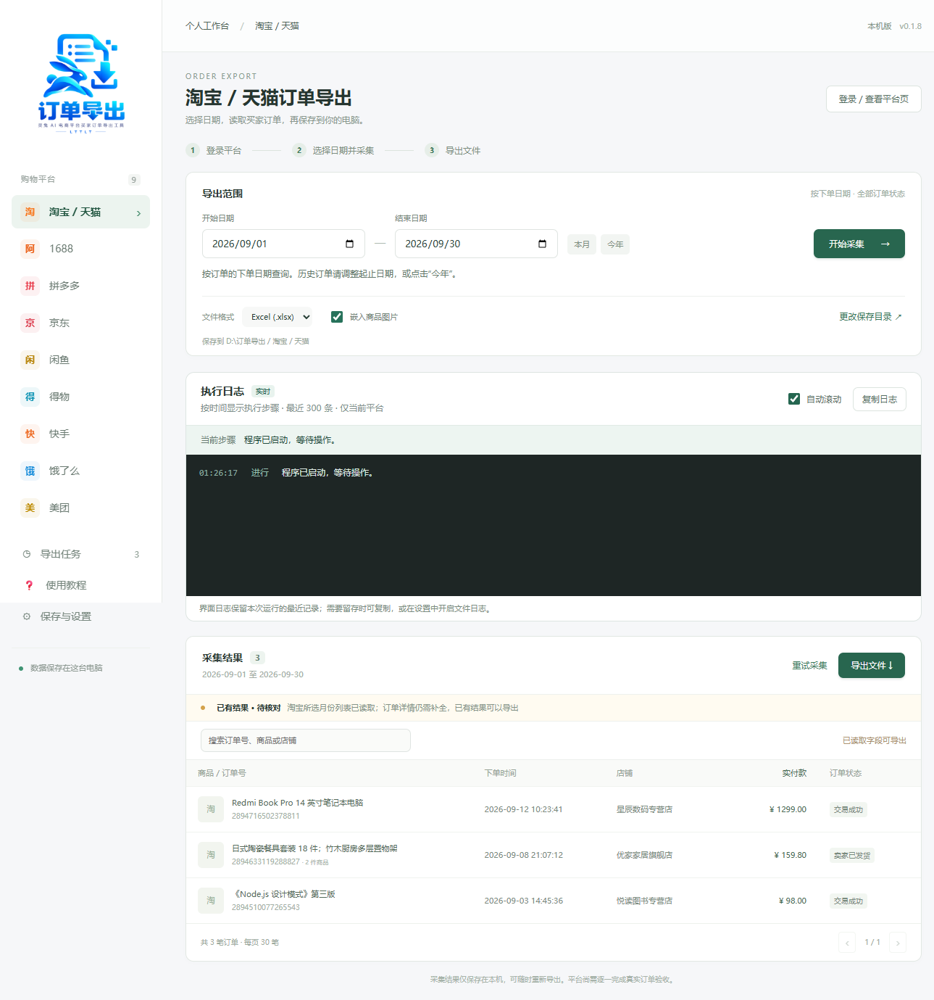
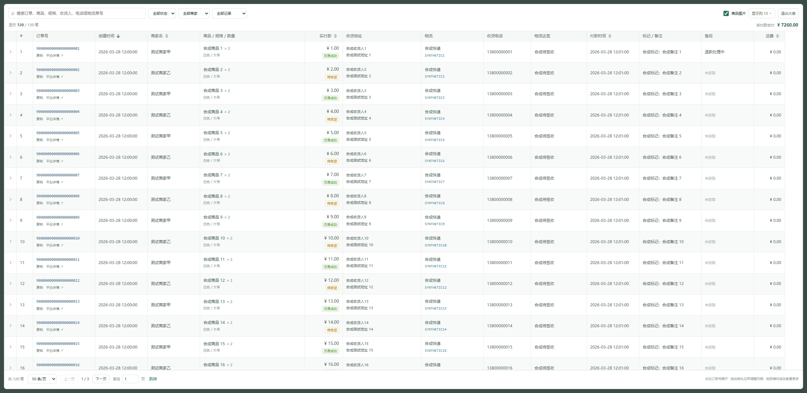

# 电商平台采购订单导出

在 Windows 电脑上采集多平台买家历史订单，导出带商品图片的 Excel 或 CSV，方便采购整理、对账与留档。

[官网下载](https://buyer.lttlt.top/) · [下载安装包](https://github.com/907609732/lingtu-order-export/releases/latest) · [图文教程](https://buyer.lttlt.top/guide.html) · [问题反馈](https://github.com/907609732/lingtu-order-export/issues) · [Gitee 仓库](https://gitee.com/chen-yuecai/lingtu-order-export)

## 主要功能

- **多平台订单导出**：淘宝 / 天猫、1688、拼多多、京东、闲鱼、得物、快手、饿了么、美团。
- **按日期采集**：选择历史订单范围，支持按月或按天制定提取计划、暂停与继续。
- **订单明细查看**：查看商品、规格、数量、金额、收货与物流信息，支持搜索、筛选和详情提取。
- **带图表格导出**：导出 Excel / CSV，Excel 可包含商品图片；任务保留在本机，可重新打开和导出。

## 快速使用

1. 下载并安装 Windows 版，选择需要导出的平台。
2. 点击“登录 / 查看平台页”，在官方页面自行登录。
3. 按订单下单时间选择日期范围，开始采集，按需提取详情。
4. 选择保存目录和 Excel / CSV 格式，点击“导出文件”。

得物、快手、饿了么、美团通过微信小程序辅助采集，证书与代理设置请按软件内教程操作，使用后恢复原代理。

## 软件截图

以下为合成演示数据。

**订单采集与导出**

**订单明细与筛选**

订单与登录状态保存在本机。软件会检查更新并发送匿名启动统计，不包含账号、订单或收货信息。

BY 五成
